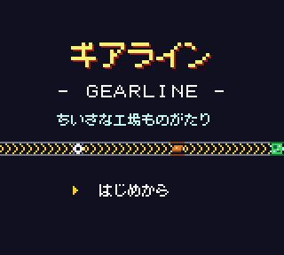
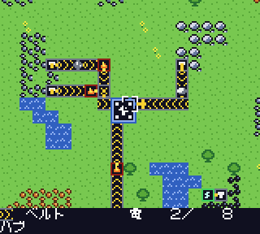
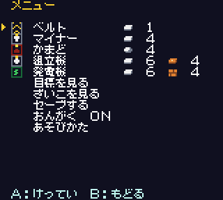
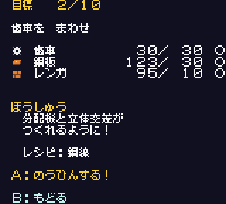

# ギアライン (GEARLINE)

ゲームボーイカラー専用の工場建設シミュレーションです。鉱石を掘り、ベルトで運び、加工して、10段階の目標を達成しながら最後にロケットの打ち上げを目指します。

アセンブリ（RGBDS）で書かれており、ゲーム内の文字はすべて日本語です。

このゲームは、Anthropic の Claude Fable 5.2 が1回の指示（ワンショット）で生成したものです。詳しくは[制作について](#制作について)を参照してください。

| タイトル | 工場 |
|---|---|
|  |  |
| **メニュー** | **目標** |
|  |  |

## 遊び方

[Releases](../../releases) から `gearline.gbc` をダウンロードし、ゲームボーイカラーに対応したエミュレーターやフラッシュカートリッジで起動してください。

- ゲームボーイカラー専用です。モノクロのゲームボーイでは起動メッセージだけが表示されます。
- セーブにはカートリッジのバッテリーバックアップRAM（8KB）を使います。メニューからのセーブと、目標を達成したときの自動セーブがあります。

### 操作

| ボタン | 動作 |
|---|---|
| 十字キー | カーソル移動 |
| A | 建てる / 組立機のレシピ変更 / ベルトの向き変更（押したまま移動で連続設置） |
| B | こわす（建設に使った材料は全額返却。押したまま移動で連続撤去） |
| SELECT | 向きを回転 |
| START | メニュー（建物選択・目標・在庫・セーブ・BGM・あそびかた） |

### ゲームの流れ

1. マイナーを鉱石の上に置いて掘り出し、ベルトでかまどへ運んで板にします。
2. できた品物をマップ中央のハブへ届けると在庫になります。在庫は建物の材料と、目標の納品に使います。
3. メニューの「目標を見る」で品物を納品すると、新しい建物やレシピが使えるようになります。
4. 10個目の目標を達成するとエンディングです。その後も工場は動かし続けられます。

建物、レシピ、目標の詳細は [docs/spec.md](docs/spec.md) にまとめています。

## ビルド

必要なもの:

- [RGBDS](https://rgbds.gbdev.io/) v1.0.4
- Python 3（標準ライブラリのみ使用）
- 初回ビルド時のインターネット接続（フォントデータの取得に使います）

```sh
./build.sh
# rgbasm 等に PATH が通っていない場合
RGBDS=/path/to/rgbds/ ./build.sh
```

`tools/gen.py` がドット絵・フォント・文字列・BGM・パレットを `build/` に生成し、`gearline.gbc` を出力します。

GitHub Actions でも同じ手順でビルドしています。`v` で始まるタグを push すると、ビルドしたROMが Releases に公開されます。

## 開発

`tools/harness.py` は [PyBoy](https://github.com/Baekalfen/PyBoy) を使った動作確認用のハーネスです。ボタン操作、メモリの読み書き、スクリーンショットの保存ができます。依存は [uv](https://docs.astral.sh/uv/) で管理しています。

```sh
./build.sh
uv sync
uv run python -c "
import sys; sys.path.insert(0, 'tools')
from harness import Game
g = Game()
g.tick(120)
print(g.shot('title'))  # build/shots/title.png
"
```

`Game()` は既定でセーブデータ（`gearline.ram` など）を削除してから起動します。

### 構成

| パス | 内容 |
|---|---|
| `src/main.asm` | ゲーム本体 |
| `tools/gen.py` | アセット生成（ドット絵・文字列・目標データ・BGMはここで定義） |
| `tools/harness.py` | PyBoy による動作確認用ハーネス |
| `build.sh` | ビルドスクリプト |
| `docs/spec.md` | ゲームと技術の仕様 |
| `docs/images/` | READMEのスクリーンショット |

## 制作について

ゲーム本体（`src/main.asm`）、アセット生成（`tools/gen.py`）、動作確認用ハーネス（`tools/harness.py`）、ビルドスクリプト（`build.sh`）は、Anthropic の Claude Fable 5.2 が1回の指示（ワンショット）で生成したものです。ゲームの仕様と内容は、生成されたときのまま変更していません。

公開にあたって、次の整理を行いました。整理の後にビルドしたROMは、生成時のROMとバイト単位で同じです。

- フォントデータをリポジトリに同梱せず、ビルド時に取得して検証するように変更（`tools/gen.py` のフォント読み込み部分のみ）
- READMEの書き直しと、仕様ドキュメント（`docs/spec.md`）・開発メモ（`AGENTS.md`）の追加
- GitHub Actions による自動ビルドとリリース
- uv による開発用依存の管理と `.gitignore` の追加
- ハーネスを使って撮影したスクリーンショットの追加

ゲーム内の説明と実際の挙動が異なる箇所などは、[docs/spec.md](docs/spec.md#既知の挙動) にまとめています。

## ライセンス

ソースコードは [MIT License](LICENSE) です。

ゲーム内の文字表示には、Little Limit さんの「[美咲フォント](https://littlelimit.net/misaki.htm)」を、たま吉さんの [Arduino-misakiUTF16](https://github.com/Tamakichi/Arduino-misakiUTF16) で変換したデータを使っています。フォントデータはこのリポジトリには含まれず、ビルド時に取得されます。ビルドしたROMには、使用する文字のグリフが含まれます。美咲フォントとArduino-misakiUTF16はいずれも、改変の有無や商用・非商用を問わず、自由に利用・複製・再配布できるフリーソフトウェアです（無保証）。
